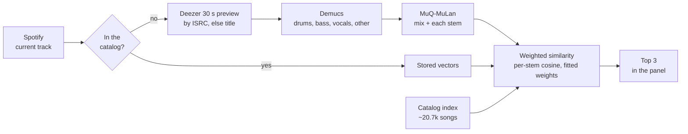

# Overtone

A desktop panel for music producers that docks beside the Spotify app and follows whatever is playing: it finds similar songs by how they actually sound, and suggests chord progressions in the style of the current song.


**[Download for Windows](https://github.com/Nicolas-Cunderlik/Overtone/releases/latest)**, then follow [Install](#install).

## What it does

- **Similar songs**: the three closest songs from a ~20.7k-song catalog, compared on the mix and on each stem (drums, bass, vocals, other). No play counts are involved, so a niche song competes on equal terms with a hit. Click one to play it (Spotify Premium) or open it in Spotify.
- **Chord progressions**: three progressions in the style of the current song, checked against music-theory rules. Click one to save it as a MIDI file.
- **Docked panel**: sits next to the Spotify desktop app, shows and hides with its window, and follows playback.

## How it works



A song outside the catalog is analysed from its preview (about 1.5 s on a GPU) and remembered. The per-stem weights are fitted on human similarity judgments by the research pipeline in `research/stem_similarity`, which also builds the catalog index with the same analysis code, so live and catalog songs are directly comparable.

## Results

Share of human similarity judgments each model agrees with ("which of these two sounds more like the reference?"):

| Model | Producer's ABX ratings | DIM-SIM | MagnaTagATune |
|---|---|---|---|
| Random | 50% | 50% | 50% |
| Spotify audio features, kNN (previous model) | 58% (30-83) | - | - |
| MuQ-MuLan, mix only | 85% (67-100) | 64% | 75% |
| **Stems, fitted weights (current model)** | **85% (67-100)** | **66%** | **76%** |
| Judgments | 13 | 1,792 | 582 |

95% bootstrap confidence intervals in brackets. The ABX ratings are held out: nothing is fitted on them. DIM-SIM and MagnaTagATune are scored out-of-fold. The feature model can only be scored on the ABX ratings, the one set whose songs have Spotify features. Fitted stems beat the mix alone only on DIM-SIM (+2.3 points, 95% CI +0.7 to +3.8).

## Limitations

- **The model is, in effect, Demucs feeding MuQ-MuLan.** Fitting weights over the stems barely improves on the mix alone. A real improvement will have to come from fine-tuning the embeddings per stem, or a new approach, not from re-weighting.
- **Little ground truth.** 13 ABX ratings from one producer, so the intervals are wide.
- **30-second previews** stand in for whole songs, and the catalog is a song list from 2020.
- **Windows only**, next to the Spotify desktop app. Non-commercial: the MuQ-MuLan weights and DIM-SIM are licensed CC BY-NC 4.0.

## Install

You need Windows 10 or 11 (64-bit), the Spotify desktop app and about 10 GB of free disk space. An NVIDIA GPU makes analysing new songs fast (about 1.5 s on an RTX 3070, about 35 s on the CPU).

**1. Make your Spotify keys** (about 5 minutes, once). Overtone reads what's playing through your own Spotify developer app:

1. Log in at [developer.spotify.com/dashboard](https://developer.spotify.com/dashboard) and click **Create app**.
2. Give it any name and description. Under **Redirect URIs** add `http://127.0.0.1:4000`, tick **Web API**, accept the terms and save.
3. In the app's **Settings**, copy the **Client ID** and the **Client secret** (**View client secret**).

Optional: an [OpenAI API key](https://platform.openai.com/api-keys) for the chord suggestions. Everything else works without one.

**2. Run the installer.** Download `Overtone-setup-<version>.exe` from the [latest release](https://github.com/Nicolas-Cunderlik/Overtone/releases/latest) and run it. The installer isn't signed, so Windows SmartScreen warns: click **More info**, then **Run anyway**. Paste your keys when asked. Setup then downloads Python and the exact tested packages, and the catalog index (both checked against pinned hashes), then the model weights during a self-test.

**3. Start Overtone** from the Start menu while Spotify is open. The first time, a browser window asks you to allow access to your Spotify account.

Everything goes into `%LOCALAPPDATA%\Programs\Overtone`, with your keys in its `.env` file. A newer installer upgrades in place and keeps your keys. If setup stops, run it again: it continues where it stopped (log: `install\install.log`). Uninstall from Windows Settings → Apps.

## Development

Needs Python 3.13 and [uv](https://docs.astral.sh/uv/).

```bash
uv sync                                          # one .venv for the app and the research pipeline
copy .env.example .env                           # then fill in the keys
python -m overtone_core.ml.model_release fetch   # the published catalog index
overtone                                         # run the app
pytest                                           # tests
```

[CLAUDE.md](CLAUDE.md) covers the code, commands and conventions; [research/stem_similarity/CLAUDE.md](research/stem_similarity/CLAUDE.md) covers the research pipeline and how the index is built.

## Credits

- **Models:** [Demucs](https://github.com/adefossez/demucs) (Meta AI, MIT) and [MuQ-MuLan](https://github.com/tencent-ailab/MuQ) (Tencent AI Lab; weights CC BY-NC 4.0). Licenses of everything the installer downloads: [THIRD_PARTY_NOTICES.md](THIRD_PARTY_NOTICES.md).
- **Similarity judgments:**
  - [DIM-SIM](https://zenodo.org/records/3889149): Lee et al., ICASSP 2020. CC BY-NC 4.0.
  - [MagnaTagATune](https://mirg.city.ac.uk/datasets/magnatagatune): Law et al., "Evaluation of algorithms using games: the case of music tagging", ISMIR 2009.
  - [CCMSim](https://github.com/pxaris/CCMSim): Xaris et al., TISMIR. Annotations CC BY 4.0.
  - [MATCHA](https://github.com/roserbatlleroca/matcha): Batlle-Roca et al. MIT.
  - Similar-track data from [Last.fm](https://www.last.fm).
- **Catalog:** the song list of the [TidyTuesday 2020-01-21](https://github.com/rfordatascience/tidytuesday/tree/master/data/2020/2020-01-21) dataset. Audio previews come from the Deezer API. Neither this repository nor the catalog index contains any audio.

## License

All rights reserved: see [LICENSE](LICENSE). Questions or suggestions: open an issue or email [nicolas7cunderlik@gmail.com](mailto:nicolas7cunderlik@gmail.com).
