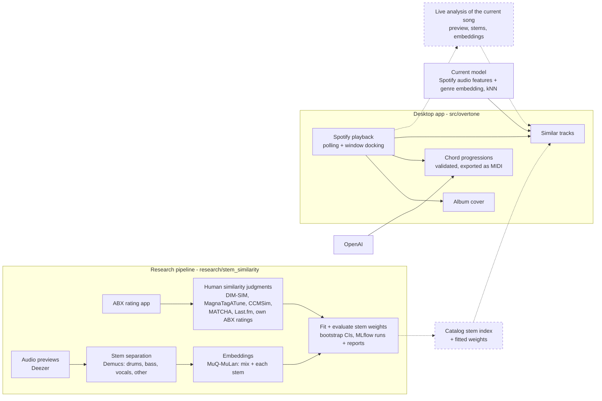

# Overtone

[Jira board](https://nicolascunderlik.atlassian.net/jira/software/c/projects/SSM/list)

A desktop panel for music producers that sits beside the Spotify app and follows whatever is playing: chord progressions in the style of the current song, exported as MIDI, and similar songs found by how they actually sound.

## Why

Streaming recommenders lean on listening behaviour (what people play together) and whole-mix descriptors like energy or danceability. That favours songs that are already popular, and it can't say *which part* of two songs is alike: a folk vocal over a trap beat matches neither folk nor trap well.

Overtone recommends from the audio alone. It splits each song into stems (drums, bass, vocals, other), embeds each one, and learns how to weigh them from human similarity judgments, including a producer's own ratings. No play counts are involved, so a new or niche song competes on equal terms with a hit, and per-stem scores make recommendations explainable ("similar bass") and, eventually, steerable.

## Architecture



Dashed parts are planned. Today, Similar Tracks uses the audio-feature model; the stem model replaces it once it proves itself on held-out ratings.

## Features

- **Docked panel**: sits to the left of the Spotify desktop app, shows and hides with its window, and follows playback.
- **Chord progressions**: three progressions in the style of the current song, checked against music-theory rules (the model is re-asked when they fail) and cached for a day. Click one to save it as a MIDI file to Downloads.
- **Similar tracks**: the three closest songs from a ~25.6k-song catalog, by Spotify audio features plus a learned genre embedding. Click one to play it (Spotify Premium) or open it in Spotify. Songs outside the catalog get no suggestions yet.
- **Album cover view**: click the cover to scale it to your display (Esc or Space closes it).
- **Responsive UI**: all Spotify, OpenAI and network calls run on worker threads.

## Research status

The stem-similarity study (`research/stem_similarity`) has separated and embedded about 30k tracks and fits per-stem weights against human judgments. So far:

- Combining stems agrees with listeners more than the mix alone on DIM-SIM: +2.7 points (95% CI +1.1 to +4.3). On MagnaTagATune and the held-out sets no gain is shown yet.
- The MuQ-MuLan mix embedding already beats the app's current feature model on the author's ABX ratings: +26.7 points (95% CI +6.7 to +53.3, 15 ratings).
- Each stem alone is weaker than the mix, and learned weights don't yet beat equal weights. More ABX ratings are the main bottleneck.

## Roadmap

- **Stem-based similar tracks**: a precomputed stem index for the catalog, live analysis of the current song from its preview, and the model packaged into the app.
- **Similar tracks for any song**, not just the catalog.
- **Faster ABX ratings**: a rating app that picks the most informative comparisons, in short sessions.
- **Explanations and steering**: "recommended because: similar bass", and requests like "like this, but match the drums".
- **Personal taste**: a producer-specific similarity layered on the population model.
- **Better per-stem embeddings**: test how well the embedding model handles isolated stems; fine-tune or switch models if needed.
- **In-app feedback**: the thumbs up/down box on recommendations is in place but not wired yet.
- **Beyond Spotify**: other playback providers.

## Requirements

- Windows (the panel docks to Spotify's window through the Win32 API)
- Python 3.13 and the Spotify desktop app
- A Spotify developer app (client ID/secret, redirect URI `http://127.0.0.1:<port>`) and an OpenAI API key
- Research pipeline only: its own venv (`research/stem_similarity/requirements.txt`); a CUDA GPU makes separation and embedding practical

## Setup

```bash
python -m venv .venv
.venv\Scripts\activate
pip install -e ".[dev]"
pre-commit install
copy .env.example .env      # then fill in the keys
```

Build the similarity model once (downloads an 8 MB public dataset into `data/`, trains into `models/` in about a minute):

```bash
python -m overtone_core.ml.download_dataset
python -m overtone_core.ml.train
```

## Run

```bash
overtone                  # or: python -m overtone. The first run opens a Spotify login in the browser
overtone --self-test      # headless check: loads the model, exits 0 if OK
```

The login token, log and chord cache live in `%LOCALAPPDATA%\Overtone` (logs in `logs\overtone.log`).

## Build a standalone exe

```bash
pyinstaller app.spec        # -> dist/Overtone.exe (bundles the trained model)
dist\Overtone.exe --self-test
```

Put the `.env` next to the exe; secrets are never bundled.

## Development

- `pytest` runs the tests in `tests/`: `unit/` mirrors the package layout, and `unit/research/` covers the research pipeline.
- `pre-commit run --all-files` runs the linters/formatter (ruff) and file hygiene hooks.
- CI (`.github/workflows/ci.yml`) runs both on every pull request and every push to `main`.
- `python -m overtone_core.ml.evaluate` compares similarity-model variants.
- Dependencies are pinned in `pyproject.toml` (`dev` extra for tooling).

### Utility scripts

Run with any Python - each finds the right virtualenv itself:

| Script | What it does |
|---|---|
| `scripts/run_checks.py` | What CI runs: pre-commit over all files + the unit tests |
| `scripts/pipeline_status.py` | Research pipeline progress per dataset and stage, what's running, disk, latest log lines |
| `scripts/resume_pipeline.py` | Restarts downloads / GPU stages in the background; skips stages already running |
| `scripts/launch_mlflow.py` | MLflow UI over the research experiment runs (each run has a `report.md`) |
| `scripts/launch_rating_server.py` | The ABX rating app for adding your own similarity judgments |

## Project layout

```
src/overtone/               the app package (python -m overtone)
  config.py                   where files live: assets, models, .env, app data
  auth.py                     secrets from .env; Spotify / OpenAI clients
  assets/                     icon and title font
  ui/                         main window, title bar, list boxes, fullscreen cover, theme
  workers/                    QThreads: playback polling/control, data fetching
  services/                   Spotify, OpenAI chord suggestions (+cache), similarity, Win32 window tracking
  music/                      chord-progression schema/validation, MIDI export
  ml/                         similarity model: dataset download, dedup, features, embedding, train/evaluate
research/stem_similarity/   stem-similarity study (own venv: torch, Demucs, MuQ, MLflow)
  stemsim/                    datasets, registry, stages (audio, separate, embed), experiments
scripts/                    standard-library launchers (see above)
data/                       downloaded dataset (gitignored)
models/                     trained model artifacts (gitignored, bundled into the exe)
tests/                      unit/ (mirrors src/overtone/; unit/research/ for the pipeline) and integration/
run.py                      PyInstaller entry script
app.spec                    PyInstaller build
```

## License

All rights reserved - see [LICENSE](LICENSE).

## Contact

For any questions or suggestions, please open an issue or contact me at [nicolas7cunderlik@gmail.com](mailto:nicolas7cunderlik@gmail.com).
