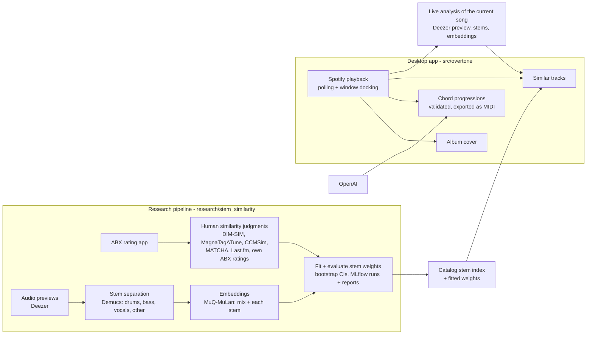

# Overtone

[Jira board](https://nicolascunderlik.atlassian.net/jira/software/c/projects/SSM/list)

A desktop panel for music producers that sits beside the Spotify app and follows whatever is playing: chord progressions in the style of the current song, exported as MIDI, and similar songs found by how they actually sound.

## Why

Streaming recommenders lean on listening behaviour (what people play together) and whole-mix descriptors like energy or danceability. That favours songs that are already popular, and it can't say *which part* of two songs is alike: a folk vocal over a trap beat matches neither folk nor trap well.

Overtone recommends from the audio alone. It splits each song into stems (drums, bass, vocals, other), embeds each one, and learns how to weigh them from human similarity judgments, including a producer's own ratings. No play counts are involved, so a new or niche song competes on equal terms with a hit, and per-stem scores make recommendations explainable ("similar bass") and, eventually, steerable.

## Architecture



The research pipeline and the app share one package, `overtone_core` (`packages/core`): the Deezer lookup and the stem analysis that build the catalog index are the same code that analyses the song playing now, so the two are directly comparable.

## Features

- **Docked panel**: sits to the left of the Spotify desktop app, shows and hides with its window, and follows playback.
- **Chord progressions**: three progressions in the style of the current song, checked against music-theory rules (the model is re-asked when they fail) and cached for a day. Click one to save it as a MIDI file to Downloads.
- **Similar tracks**: the three closest songs from a ~20.7k-song catalog by how they sound: the mix and each stem compared separately, weighted by fitted stem weights. A song outside the catalog is analysed from its Deezer preview (about 1.5 s on a GPU once the models are loaded) and remembered. Click a result to play it (Spotify Premium) or open it in Spotify.
- **Album cover view**: click the cover to scale it to your display (Esc or Space closes it).
- **Responsive UI**: all Spotify, OpenAI and network calls run on worker threads.

## Research status

The stem-similarity study (`research/stem_similarity`) has separated and embedded about 30k tracks and fits per-stem weights against human judgments. So far:

- Combining stems agrees with listeners more than the mix alone on DIM-SIM: +2.7 points (95% CI +1.1 to +4.3). On MagnaTagATune and the held-out sets no gain is shown yet.
- The MuQ-MuLan mix embedding already beats the app's current feature model on the author's ABX ratings: +26.7 points (95% CI +6.7 to +53.3, 15 ratings).
- Each stem alone is weaker than the mix, and learned weights don't yet beat equal weights. More ABX ratings are the main bottleneck.

## Roadmap

- **Installer**: a small setup program that installs the app, torch and the models with uv from the lock file.
- **Faster ABX ratings**: a rating app that picks the most informative comparisons, in short sessions.
- **Explanations and steering**: "recommended because: similar bass", and requests like "like this, but match the drums".
- **Personal taste**: a producer-specific similarity layered on the population model.
- **Better per-stem embeddings**: test how well the embedding model handles isolated stems; fine-tune or switch models if needed.
- **In-app feedback**: the thumbs up/down box on recommendations is in place but not wired yet.
- **Beyond Spotify**: other playback providers.

## Requirements

- Windows (the panel docks to Spotify's window through the Win32 API)
- Python 3.13, [uv](https://docs.astral.sh/uv/) and the Spotify desktop app
- A Spotify developer app (client ID/secret, redirect URI `http://127.0.0.1:<port>`) and an OpenAI API key
- An NVIDIA GPU makes analysing songs outside the catalog fast (about 1.5 s per song on an RTX 3070); without one it runs on the CPU (about 35 s per song)

## Setup

```bash
uv sync                           # one .venv for the app and the research pipeline, from uv.lock (~3 GB with CUDA torch)
.venv\Scripts\pre-commit install
copy .env.example .env            # then fill in the keys
```

Similar tracks need the catalog stem index in `models/stem-muq/v1/`, built by the research pipeline (`python -m stemsim index --weights-run <run id>` from `research/stem_similarity`); the installer will download it. Demucs and MuQ-MuLan download their weights on first use.

The older feature model is kept as the evaluation baseline (downloads an 8 MB public dataset into `data/`, trains into `models/` in about a minute):

```bash
python -m overtone_core.ml.download_dataset
python -m overtone_core.ml.train
```

## Run

```bash
overtone                  # or: python -m overtone. The first run opens a Spotify login in the browser
overtone --self-test      # headless check: loads the stem model and scores a catalog song, exits 0 if OK
```

The login token, log, chord cache and the stem vectors of analysed songs live in `%LOCALAPPDATA%\Overtone` (logs in `logs\overtone.log`).

## Development

- `pytest` runs the tests in `tests/`: `unit/` mirrors the app package, `unit/core/` the shared core package and `unit/research/` the research pipeline.
- `pre-commit run --all-files` runs the linters/formatter (ruff) and file hygiene hooks.
- CI (`.github/workflows/ci.yml`) runs both, plus pyright, on every pull request and every push to `main`.
- `python -m overtone_core.ml.evaluate` compares feature-model variants.
- Dependencies are pinned in each package's `pyproject.toml` and locked for the whole workspace in `uv.lock`: after changing one, run `uv lock` and `uv sync`.

### Utility scripts

Run with any Python - each uses the repo's virtualenv itself:

| Script | What it does |
|---|---|
| `scripts/run_checks.py` | What CI runs: pre-commit over all files + the unit tests |
| `scripts/pipeline_status.py` | Research pipeline progress per dataset and stage, what's running, disk, latest log lines |
| `scripts/resume_pipeline.py` | Restarts downloads / GPU stages in the background; skips stages already running |
| `scripts/launch_mlflow.py` | MLflow UI over the research experiment runs (each run has a `report.md`) |
| `scripts/launch_rating_server.py` | The ABX rating app for adding your own similarity judgments |

## Project layout

```
src/overtone/               the app package (python -m overtone)
  config.py                   where the app's files live: assets, app data, caches
  auth.py                     Spotify / OpenAI clients
  assets/                     icon and title font
  ui/                         main window, title bar, list boxes, fullscreen cover, theme
  workers/                    QThreads: playback polling/control, data fetching, similar tracks
  services/                   Spotify, OpenAI chord suggestions (+cache), similar tracks (+stem cache), Win32 window tracking
  music/                      chord-progression schema/validation, MIDI export
packages/core/              overtone_core: shared by the app and the research pipeline
  ml/                         stem model (contract, analysis, scoring), model store, dedup, feature model (baseline)
  clients/                    Deezer and Spotify API clients, HTTP plumbing
  matching.py                 whether a search hit is the recording asked for
  secrets.py, config.py       API keys from .env; repo root, HTTP settings
research/stem_similarity/   stem-similarity study (stemsim)
  stemsim/                    datasets, registry, stages (isrc, audio, separate, embed), index, experiments, rating app
scripts/                    standard-library launchers (see above)
data/                       downloaded dataset (gitignored)
models/                     model versions, models/<model>/<version>/ (gitignored)
tests/                      unit/ (mirrors src/overtone/; unit/core/ and unit/research/ for the other packages) and integration/
uv.lock                     exact versions for the whole workspace
```

## License

All rights reserved - see [LICENSE](LICENSE).

## Contact

For any questions or suggestions, please open an issue or contact me at [nicolas7cunderlik@gmail.com](mailto:nicolas7cunderlik@gmail.com).
